# Wasteland 荒野遊俠：繁簡中文重製版

以 Go／Ebitengine 重寫 1988 年 DOS 版《Wasteland》，保留核廢土冒險、隊伍管理與回合戰鬥，
加入中文手札、滑鼠操作、兩種高解析美術與現代介面。

[V2.0.0 新版](#v200-新版) · [V1.0.0 舊版](#v100-舊版) · [故事背景與台灣版本史](#1998-年衛星從天上消失) · [玩家回報與修正](#玩家回報與修正) · [如何執行](#如何執行) · [文件與驗證](#文件與驗證)

玩家需自備合法原版。下方圖片供展示成果；原始遊戲資料、完整衍生圖包與含素材的完整包留在本機。

## V2.0.0 新版

正式版號為 `v.2.0.0-20261029`。預設使用源泉圓體、18 像素文字、細邊框與常駐工具列，
支援繁體中文與簡體中文。下圖為最終完整測試包的實際遊戲畫面。

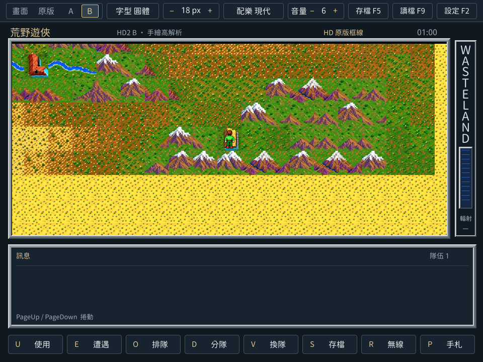

### 優化了哪些事情

| 項目 | V1.0.0 舊版 | V2.0.0 新版 |
|---|---|---|
| 中文 | 繁體中文 | 新增簡體中文；一般文字、選單與 162 段手札都可切換 |
| 字型 | 倚天點陣字，需自備字型 | 內建源泉圓體與 Noto 黑體，從工具列切換 |
| 字級 | 大字點陣排版 | 預設 18 像素，可選 16／18／20 像素 |
| 邊框與版面 | 厚灰框、原版式訊息區 | 細邊框、統一留白與深色面板；地圖可視範圍維持相同 |
| 工具列 | 主要依賴功能鍵與設定選單 | 新增頂部常駐工具列，可選字型、字級、美術、配樂、音量與存讀檔；從「設定 F2」切換語言 |
| 人物與手札 | 點陣文字與舊式訊息視窗 | 人物、物品、手札與設定改為展開面板，文字依面板範圍排版 |
| 美術 | 原版、HD2 A、HD2 B | 沿用三種美術，改由工具列直接切換；下方補齊兩種圖包總覽 |
| 配樂 | 復古與振奮版現代配樂 | 沿用十首重編現代配樂及復古版，可直接切換與調音量 |

兩張對照都使用 HD2 B，展示相同地圖視窗下的介面差異。訊息內容與動畫影格不同。

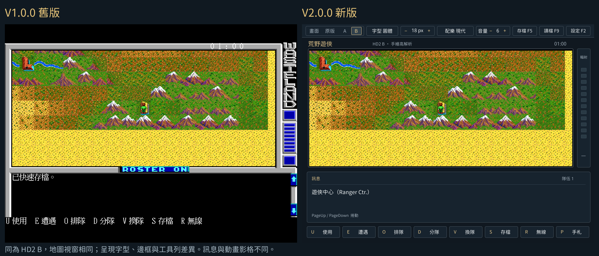

### 新增工具列：選擇語言與字型

頂部工具列將常用設定集中在遊戲畫面中，不必離開遊戲：

| 功能 | 操作方式 |
|---|---|
| 語言 | 點「設定 F2」，再點語言按鈕或按 `L`，切換繁體中文／簡體中文 |
| 字型 | 點「字型 圓體／Noto」，切換源泉圓體與 Noto 黑體 |
| 字級 | 點字級旁的 `−`／`+`，選擇 16／18／20 像素 |
| 美術 | 點「原版／A／B」，切換原版、細緻像素與手繪高解析 |
| 配樂與音量 | 點配樂按鈕切換復古／現代版，點音量旁的 `−`／`+` 調整音量 |
| 快速存讀檔 | 點「存檔 F5／讀檔 F9」 |

語言可在標題或一般地圖切換；請先關閉人物、手札等其他操作選單。
切換語言或字型會保留目前隊伍與遊戲進度。實際畫面見下方的繁簡設定截圖，
字型範例可看 [Noto 18 像素](docs/images/v2.0.0/font-noto-18.png)。
玩家回報的修正與確認結果另列於 [回報處理表](#玩家回報與修正)。

### 遊戲截圖

以下都是最終 Linux 完整測試包從正常標題進入後擷取的畫面，沒有注入地圖或角色。
圖片保留完整的 960×720 邏輯畫布，點擊圖片可查看原尺寸。

| 原版美術搭配新版介面 | HD2 A 細緻像素 |
|---|---|
| [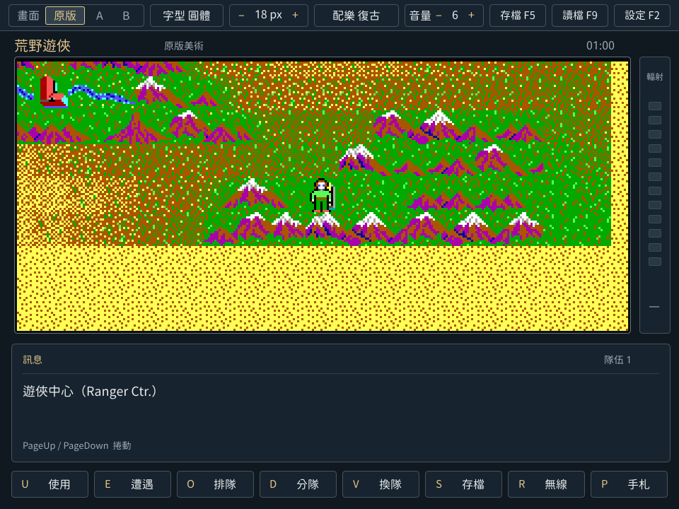](docs/images/v2.0.0/map-original.png) | [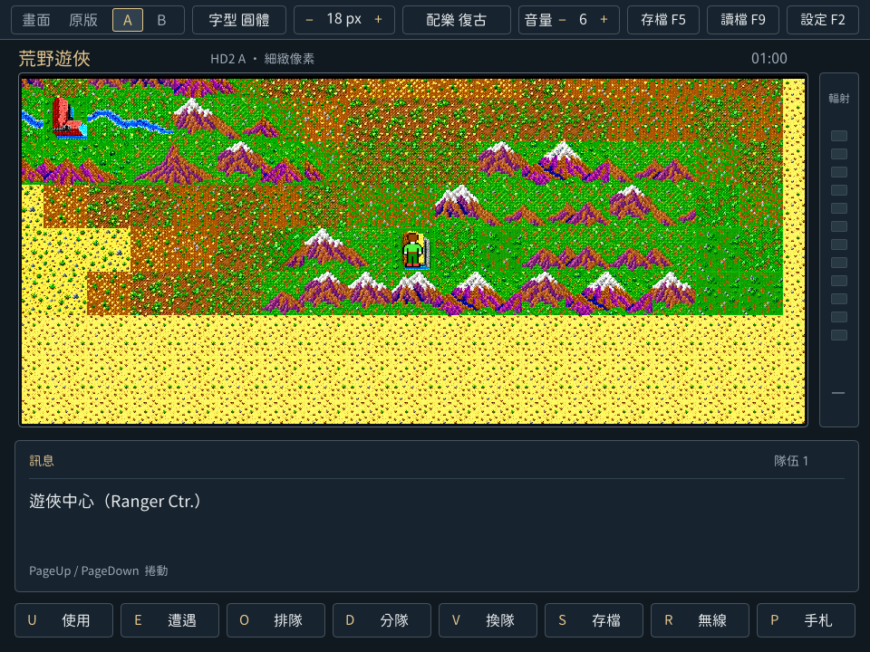](docs/images/v2.0.0/map-hd2-a.png) |

| 人物資料 | 繁體物品欄 |
|---|---|
| [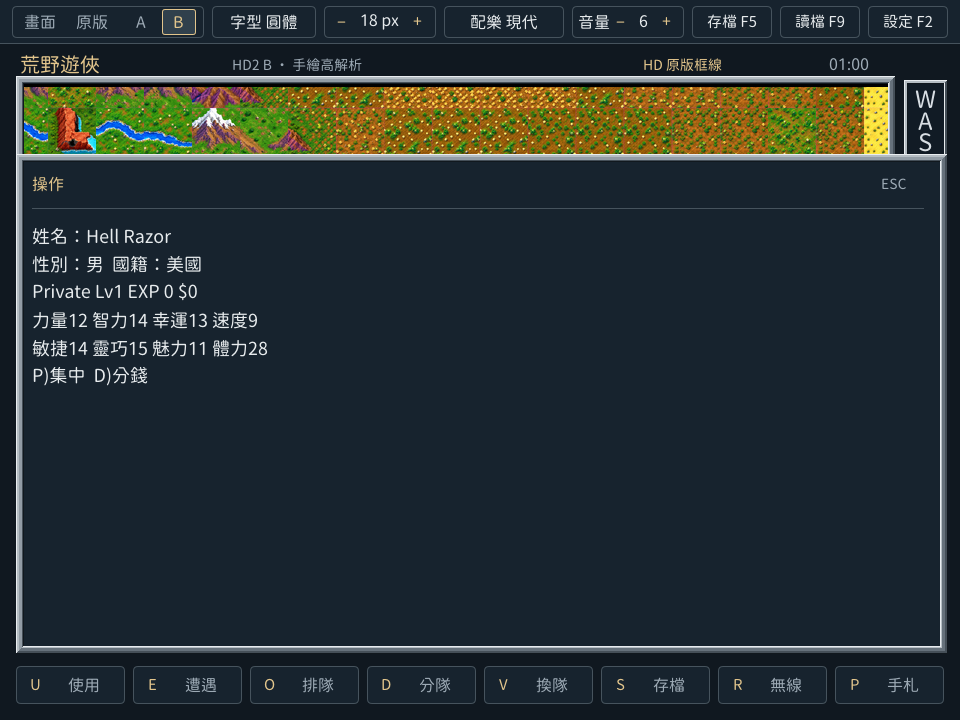](docs/images/v2.0.0/character.png) | [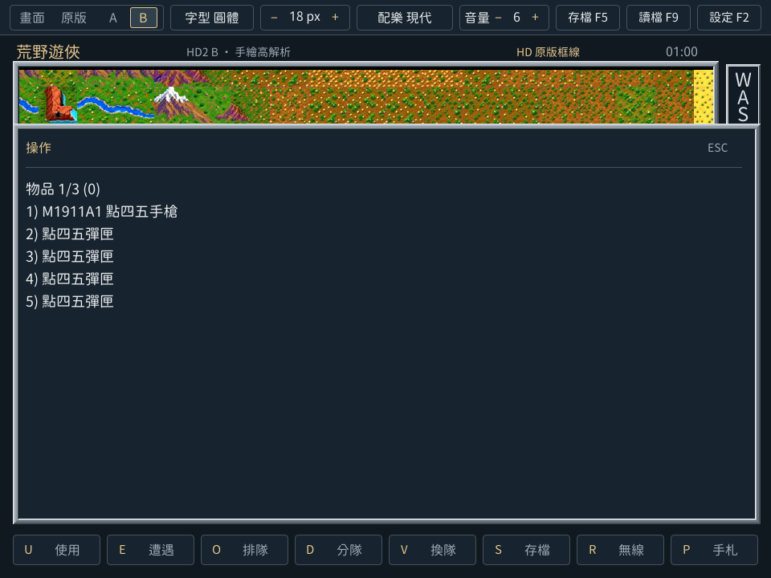](docs/images/v2.0.0/items-hant.png) |

| 繁體中文手札 | 簡體中文手札 |
|---|---|
| [](docs/images/v2.0.0/journal-hant.png) | [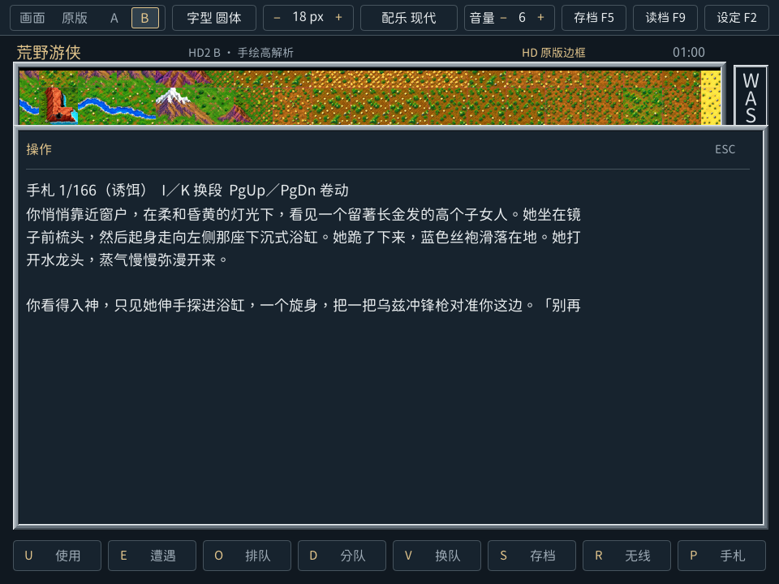](docs/images/v2.0.0/journal-hans.png) |

| 繁體設定與語言按鈕 | 切換為簡體中文 |
|---|---|
| [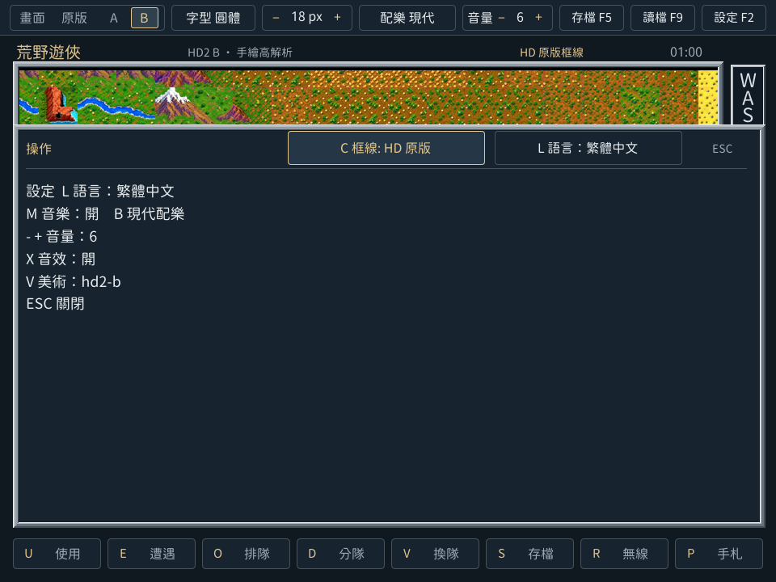](docs/images/v2.0.0/settings-hant.png) | [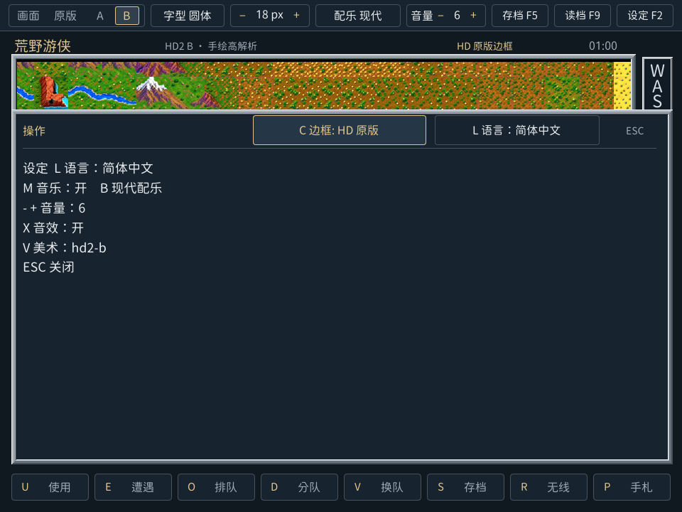](docs/images/v2.0.0/settings-hans.png) |

| 遊俠中心 | 簡體物品欄 |
|---|---|
| [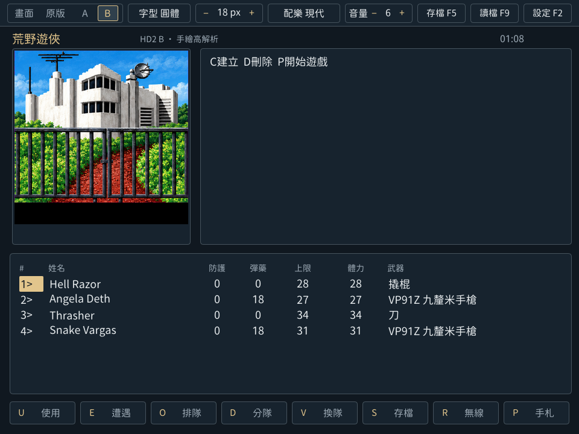](docs/images/v2.0.0/ranger-center.png) | [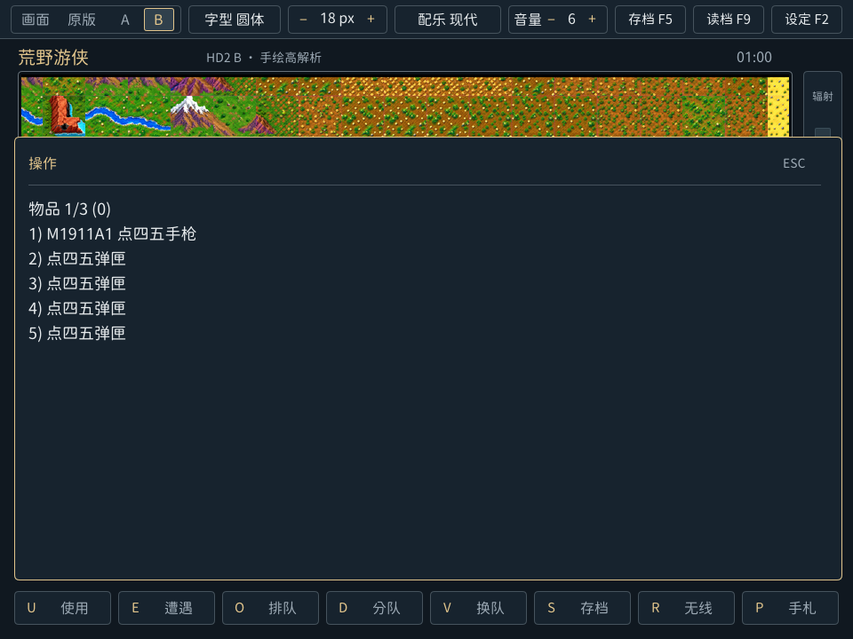](docs/images/v2.0.0/items-hans.png) |

更多實機畫面：[標題](docs/images/v2.0.0/title.png)、[簡體地圖](docs/images/v2.0.0/map-hans.png)、
[Noto 16 像素](docs/images/v2.0.0/font-noto-16.png)、[Noto 18 像素](docs/images/v2.0.0/font-noto-18.png)、
[Noto 20 像素](docs/images/v2.0.0/font-noto-20.png)。

### V2.0.0 素材總覽

HD2 A 採細緻像素，HD2 B 採手繪高解析。兩版均以原版的輪廓、配色與物件為參考，
保留相同的地圖、碰撞、事件與存檔。舊 HD 已取消，不列入現行美術選單。

下圖從最終 V2.0.0 封包的實際素材製作，包含標題、人物、怪物、地形、隊伍動畫與圖示精選。
這是素材展示拼圖；遊戲實際呈現見上方截圖。

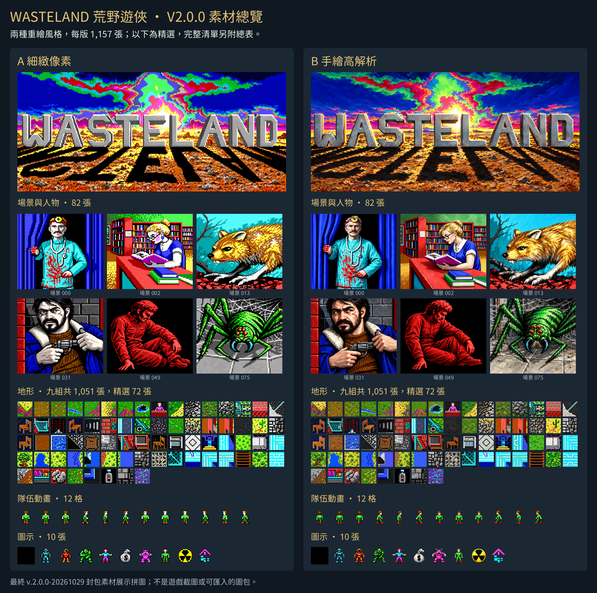

| 素材類別 | HD2 A | HD2 B |
|---|---:|---:|
| 地形，九組圖塊 | 1,051 張 | 1,051 張 |
| 場景與人物 | 82 張 | 82 張 |
| 隊伍動畫 | 12 格 | 12 格 |
| 圖示 | 10 張 | 10 張 |
| 標題與結局 | 2 張 | 2 張 |
| **合計** | **1,157 張** | **1,157 張** |

### 全部事件／人物場景圖

原版的 82 張事件／人物場景圖，A、B 均有對應的 288×252 HD 重繪。
已核對 000–081 全部編號、圖片尺寸與封包雜湊，並確認每張都與原圖的最近鄰放大結果不同。
下圖收錄全部 164 張，依編號左 A、右 B 並排，不省略重複人物或後期事件。
點擊可開啟完整尺寸總覽。

[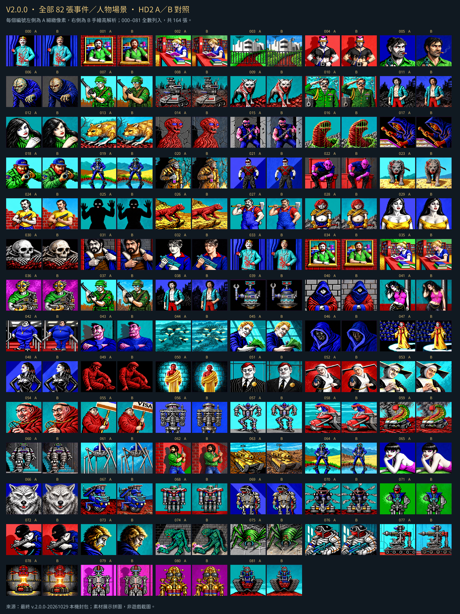](docs/images/v2.0.0/events-hd2-all.png)

完整素材總表逐張標示索引，包含精選圖中未展示的素材：

- [HD2 A：全部 1,157 張素材總表](docs/images/v2.0.0/assets-hd2-a-all.png)
- [HD2 B：全部 1,157 張素材總表](docs/images/v2.0.0/assets-hd2-b-all.png)

完整圖包隨本機 `full-local` 包使用。上述總覽圖供閱讀與比較，不是可匯入遊戲的圖包。
製作方法、來源與驗證邊界見 [HD2 規格](docs/spec/32-hd2.md)及
[製作台帳](artwork/manifests/hd2-production.json)。

### 配樂與驗證範圍

現代版十首配樂已依「振奮人心」的方向重新編排主題動機、銅管、弦樂與節奏，
涵蓋標題、探索、城鎮、設施、戰鬥及結局。復古版保留 MT-32 音色，兩套都能從工具列切換。
1988 年 DOS 原版只有 PC 喇叭音效，這兩套背景配樂都是專案自作。

兩種語言各有 5,285 條一般文字與 162 段手札。語言切換保留遊戲世界、隊伍與存檔內容，
密語答案與熱鍵字母沿用原版。Linux 與 Windows Wine 已抽測美術、字型、字級、繁簡切換、
人物、物品、手札、設施、存讀檔與退出；原生 Windows／macOS 與人工全程通關尚未驗收。
詳細現況以 [CONTEXT.md](CONTEXT.md)為準。

本機交付入口：[V2.0.0 六個測試包](dist-all/v.2.0.0-20261029/README.md)及
[重新錄製的 73 秒推廣影片](dist-all/v.2.0.0-20261029/promo/wasteland-cht-v.2.0.0-20261029-promo.mp4)。
這些含原版素材的產物留在本機，不隨 Git 散布。

## V1.0.0 舊版

正式版號為 `v.1.0.0-20261029`。這是保留點陣文字與厚灰框的上一版介面，支援繁體中文。
它已包含原版／HD2 A／HD2 B 與復古／現代雙配樂。下圖來自該版的實際完整測試包，
沒有把早期開發圖當成 V1.0.0 截圖。

| 舊版標題 | 原版美術與舊版介面 |
|---|---|
| [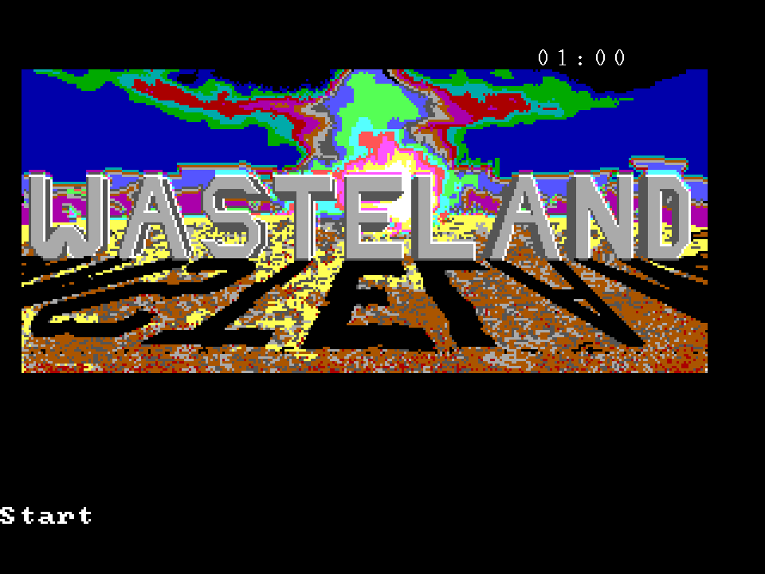](docs/images/v1.0.0/title.png) | [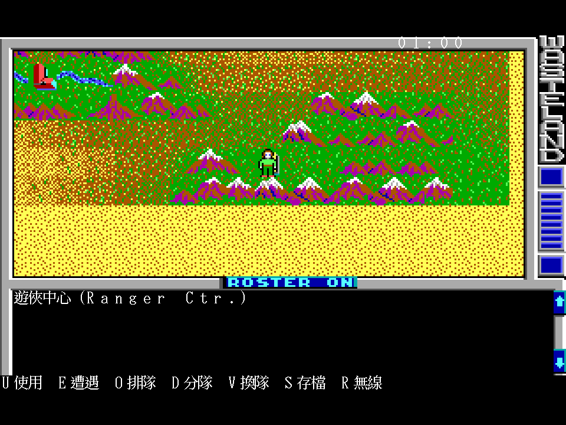](docs/images/v1.0.0/map-original.png) |

| HD2 B 與舊版介面 | 舊版設定 |
|---|---|
| [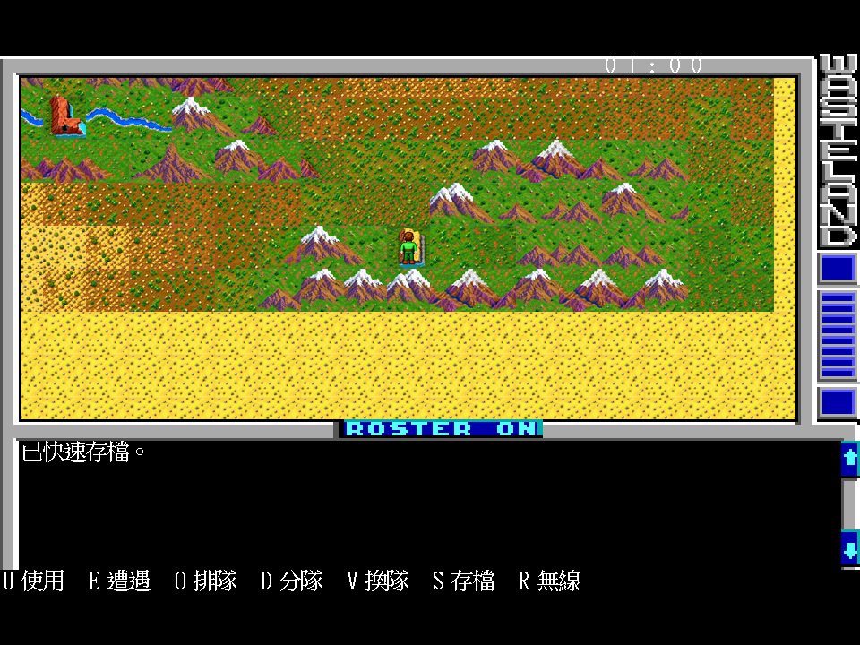](docs/images/v1.0.0/map-hd2-b.png) | [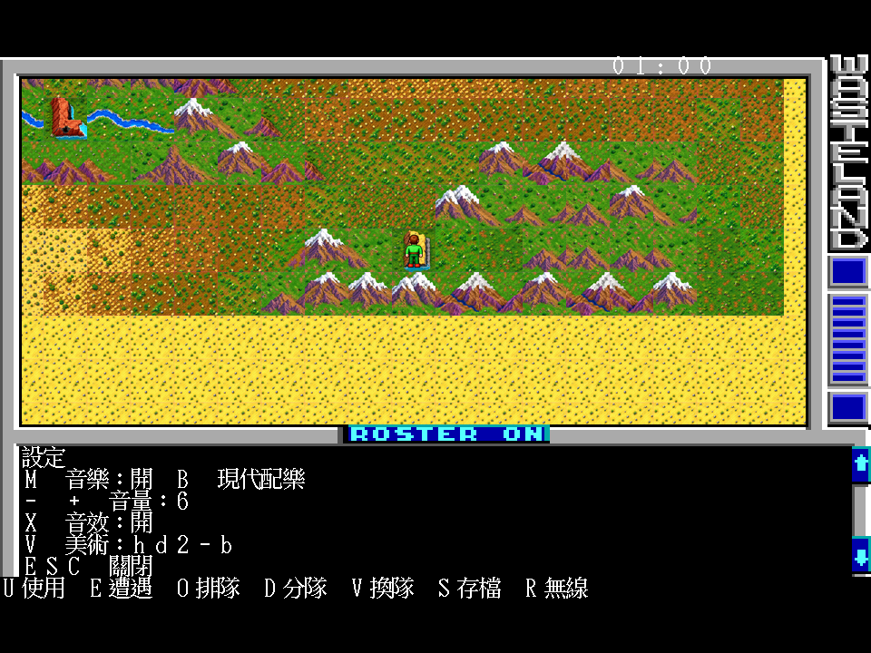](docs/images/v1.0.0/settings.png) |

舊版完整保留於 [V1.0.0 本機交付目錄](dist-all/v.1.0.0-20261029/README.md)。
圓體介面的過渡版本 `v.1.0.1-20261029` 也保留，兩者均未被新版覆寫。

以下保留原有故事背景、玩法與當年譯文介紹；現行操作方式見 [如何執行](#如何執行)。

## 1998 年，衛星從天上消失

上面那幾張圖是重製版跑出來的。至於畫面裡那支四人小隊為什麼會走在沙漠中間，
得從 1998 年講起——遊戲設定裡的 1998 年。

軟體世界那本說明書第一章就把來龍去脈交代完了：美國的「城堡」星站由軍方接管，
蘇聯抗議，中立國一個個選邊，六週內只剩三個國家還宣稱中立。然後：

> 　　當“城堡”正式啟用的兩週前，傳來一個不幸的訊息。就在訊息發出的同時，突然大部份的衛星在空中消失，脫離地球的引力圈。在驚慌中，美蘇雙方將 90％ 的核子武器射向天空。這場毀滅相當劇烈，但不徹底。
>
> —— 軟體世界中文說明書〈一、故事介紹〉（[ch01](docs/manual-cht/ch01-story-and-start.md)）

那一天，一隊美國陸軍工程師正在西南部的沙漠裡替乾河床架橋。核彈落下後他們往南邊躲，
接管了那座剛蓋好的聯邦監獄，把死刑犯趕進荒漠。幾星期後他們邀鄰近的難民一起重建，
彼此的猜忌花了很久才消掉。這個聚落後來叫 Ranger Center，說明書給它的中文名字是流浪者中心。
再往後，「擁有一世紀前德州（Texas）與亞利桑納州（Arizona）流浪者優良傳統的
Desert Rangers 誕生了」——你操作的就是這支隊伍。

軟體世界在 CD 盒背面是這樣賣它的：

> 　　不再有虛幻飄渺的法術，不再有猙獰可怖的妖物，在這個核戰後的世界裏，手上緊握的自動步槍、手榴彈、反坦克榴彈，甚至雷射武器將會是你的神劍魔刀。⋯⋯拿起你的烏茲衝鋒槍，走吧！子彈會為你我開路……
>
> —— CD 盒背面文案（[ch08](docs/manual-cht/ch08-package-and-ads.md)）

這段文案沒有誇大。Wasteland 沒有法術欄，隊伍帶的是 7.62mm 與 9mm 彈匣，
彈藥要花錢買，打完一場架地上留下一個袋子等你搜。封面右下角貼著「2 片裝・只賣 NT150 元」。

## 一個沙漠流浪者由什麼構成

文案裡那個「精英戰士」，在遊戲裡的實際樣子是一張數字表。進 Ranger Center 按 `C`，
右上角視窗用亂數擲出一組屬性，不滿意就按空白鍵重擲，滿意了按 RETURN 取名字。
原版的名字欄是 13 個 byte；重製版可以打**十個中文字**——存檔那一格照舊寫得下的部分，
完整名字放進旁邊一個自己的小檔（`WLNAMES`），原版存檔一個 byte 都不動。
說明書逐項解釋這些數字，其中決定戰力的是七項屬性：

| 縮寫 | 中譯 | 說明書怎麼描述 |
|---|---|---|
| ST | 力量 | 打敗敵人及抬起、移動或打破物件的能力，肉搏與破門時特別重要 |
| IQ | 智慧 | 決定能學多少技能，一開始的技能點數與 IQ 相等 |
| LK | 運氣 | 較能躲開敵人攻擊或找到多東西，肉搏戰中表現也較好 |
| SP | 速度 | 越高越能逃離危險的局面 |
| AGL | 敏捷 | 行動的靈巧程度，「使你可閃開對方的一擊並跳上桌子」 |
| DEX | 反應力 | 主宰開鎖或瞄準，「在『三隻手』的技巧上格外有用」 |
| CHR | 魅力 | 「效用雖不明顯，但試圖使某些人相信你時能決定你的生死」 |

—— 屬性說明取自〈三、人物的創設與檢閱〉（[ch02](docs/manual-cht/ch02-characters-and-skills.md)）

IQ 直接換算成技能點數（SKP），而技能是越練越貴的：Clip Pistol 學第一級花 1 點，
第二級 2 點，第三級 4 點。說明書把技能按所需 IQ 分段列出，二十七項，
從 IQ3 的爭鬥、攀爬、游水，一路排到 IQ17 的冶金。條目寫得像有人在旁邊講話：

> **Demolition 爆破(1)：** 教你用多少炸藥才不會把自己炸到九霄雲外的技能。
>
> **Bureaucrac 政治(1)：** 雖然大部份平民都死於核彈之下，卻有為數甚多的下級官吏活了下來；此技能協助你在和他們交涉時能予求予取。

表列完之後，說明書留了一句懸念：「這裏的技能只列到 IQ17，但誰知道 IQ 達到 18 以上是否還有新的技能呢？」
那年沒有 wiki 可查，想知道答案得自己把 IQ 18 的人物擲出來。同一頁還有一條很直接的建議——
「Medic 最好有二人以上學到，以 LEV 在 1 以上比較保險」。理由要等時間開始走才會浮出來。

## 沙漠裡的時鐘

用 `I` `J` `K` `L` 四個鍵移動。走到城鎮、建築或商店旁邊，畫面會問 `Enter New Location（Y／N）？`，
按 `Y` 進去——同時磁碟機會轉一下。說明書提醒這一下不是白轉的：

> 　　同時磁片上的資料也更新為你目前所在的位置，這個過程等於你用 Save 指令存下進度。
>
> —— 〈四、旅行〉（[ch03](docs/manual-cht/ch03-travel.md)）

反過來，這也給了當年玩家一條退路：「假如你的隊員在冒險途中不幸陣亡了，沒有關係，
只要你沒把進度存下來，可再重新開機把他召回來」——代價是這段期間撿到的東西一併蒸發。

不想動的時候按 ESC，時間照樣走，右上角的鐘會跳，生命力慢慢回。說明書注意到一件事：
「在野外按一次 ESC 休息的時間要比在城內長，故在野外休息回復得較快。」
官方英文手冊補上了原理——地圖有大小之分，沙漠圖裡裝著城市圖，城市圖裡裝著建築與下水道，
同一個按鍵在不同尺度的地圖上推進的時間不一樣。而時間對誰都一樣：

> Remember that time waits for no one. Disbanding one character and sending him off across the desert to find a doctor will not freeze time for a seriously-wounded character.
>
> —— 官方英文手冊 TIME AND DISTANCE（[05-injuries-time-places](docs/manual/05-injuries-time-places.md)）

派一個人穿過沙漠去找醫生，重傷的隊員不會在原地等你。這就是為什麼隊伍裡要有兩個人會 Medic。

畫面最底下那列 `Use Enc Order Disband View Save Radio`（本文第一張截圖底部那一排）是隨時能下的六個指令。
Disband 把隊伍拆成最多四支，因為敵人一次只打一支，而且有些地方一次只過得了一個人；
要永久遣散 NPC 的時候，說明書給了一句很實際的提醒：「別忘了先剝下他的裝備。」
Radio 則是回報總部要求升級——MAXCON 加 2 點、兩點自由分配到屬性上、階級改寫。
說明書建議每打完一場就發一次，因為檢閱畫面根本不顯示經驗值，你看不出來夠不夠。

## 你開槍，他們也開槍

會用到 Radio，通常表示前一場架打贏了。而 Wasteland 的槍戰是同時結算的，
英文手冊講得很白：

> Sure, it’s exciting when you burn a clip of AK-97 ammo into an onrushing horde of mutant bikers, but your excitement may diminish somewhat when you find that the mutants are returning fire with equal fervor. You shoot, they shoot.
>
> —— 官方英文手冊 Missile Weapon Combat（[03-commands-and-combat](docs/manual/03-commands-and-combat.md)）

武器分長、中、短三段射程：長程是 AK-97、M1989A1、M19 來福槍、M17 卡賓槍與 LAW 火箭，
中程是 Mac17 與 UZI 27 衝鋒槍，短程是兩把手槍與手榴彈。自動武器可以選單發、
三發點放（Burst）或全自動——全自動把整個彈匣倒出去，命中最高也最燒子彈。
爆炸物的 AMM 永遠顯示 1，丟掉一顆自動補上下一顆，只有 LAW 火箭打完要重新裝備。
卡彈的代價很重：「若戰鬥中你的武器卡彈（Jammed）了，所有彈匣中子彈都會報銷。」

一場仗值不值得打，看的是 CON 掉到 1 以下之後那張表。狀態欄不再顯示數字，
改成三個字母：

| 重傷級數 | 狀況 | CON 訊息 |
|---|---|---|
| 1 | 不省人事 | UNC |
| 2 | 重傷 | SER |
| 3 | 奄奄一息 | CRI |
| 4 | 致命傷 | MOR |
| 5 | 休克 | COM |
| 6 | 死亡 | DEA |

—— 〈五、戰鬥與生命狀況〉（[ch04](docs/manual-cht/ch04-combat.md)）

不省人事會自己醒。從重傷開始就不會了：沒人治療只會一路往下掉，重傷、奄奄一息、
致命傷、休克，最後是 DEA，而死亡是永久的，要用 Disband 把人埋掉。
說明書那一章的收尾是這麼寫的：「唯有健康的隊伍才能迎接任何挑戰，隨時注意各隊員的狀況，
必要時不要吝於進醫院，優秀的隊員是金錢買不到的。」
真的全隊倒下時，左上角會換成一顆骷髏頭，名字叫 Grim Reaper，訊息視窗只有兩行：
`Your life has ended in the Wasteland...`

## 印在紙上的 162 段劇情

打贏打輸都不影響下一件事：玩到某些地方，訊息列會冒出一行 `See Paragraphs ×××`。
遊戲不告訴你發生了什麼，它要你去翻書。

軟體世界把 162 段全部譯成中文，排在說明書第 21 到 47 頁，佔了整本一半以上，
章名就叫「七、劇本」。CD 盒背面把這件事列為特點之一：「唯一採用 “劇本” 式訊息的 RPG，
不但加強了遊戲的戲劇效果，也省去了抄寫訊息之苦。」這同時也是一道防拷門：沒有那本書，
劇情就只剩編號。

第 001 段是留給沒有書的人的：

> **001** 你爬上窗檻，在柔和的晨光中看見一位高䠷的金髮女郎。⋯⋯她忽然一轉身，拿著一把烏茲槍指向你，警告說：「小子，停止閱讀你未被允許讀的劇本，下次我會要求他們把我放在 Bard's Tale 中，Wasteland 這趟任務實在太危險了。」
>
> —— 〈七、劇本〉第 001 段（[ch06](docs/manual-cht/ch06-paragraphs.md)）

這種自曝身分的陷阱段落有三段（001、022、145）。除此之外還有一層更難繞過的設計：
同一個場景常常寫成兩三份，只有密語或號碼不同——Crumb 給的通關密語有 PHOENIX、KESTREL、
CLOVER 三個版本，Ugly 的炸彈解除碼有兩組數字。抄來的答案不一定在你的存檔上成立。
另外還有一整條假劇情線，火星、Phobos、火星皇帝，二十幾段寫得煞有介事。
編號、變體組與誘餌線的整理在 [`docs/paragraphs/`](docs/paragraphs/)；
重製版怎麼處理這本書，見下面的「說明書」一段。

## 1988 年 12 月，台灣就有人在寫這款遊戲的攻略

比軟體世界那本說明書早一年半、與美國原版同年，《精訊電腦》第 27 期登了一篇
Apple II 版的攻略。標題是一副對聯：

> 傲嘯荒漠　遊俠仗義江湖行
> 浮萍半生　神鎗漂泊走天涯
>
> —— 精訊電腦〈遊騎兵手記〉，1988 年 12 月（[逐頁轉錄](docs/walkthrough/jingxun-027/)）

體例與 1990 年那本完全不同：它是**第一人稱的手記**，以隊上繪圖員 Fox 的口吻寫成，
四個人物有名字、有個性，遇敵、談判、賭博、隊友差點被怪物當午餐都寫進去，
攻略資訊藏在敘事裡。作者「銀狐」自己畫了六張地圖——世界地圖、高池鎮、農業中心、
沙漠遊牧民族、礦坑、石英城與酒吧。

它把 Ranger 譯成**遊騎兵**（軟體世界譯「遊俠」，代理版封面寫「荒野遊俠」），
三種叫法都留著。

當年的敘述與今天倒出來的資料還對得上。它寫礦坑裡那口箱子
「只帶走一條繩索，並且每人拿了一個防毒面具」，而資料裡那一筆寶箱記錄是：

```
| 43 | game1 | 2 |  | 54 Rope、47 Gas mask ×4 |
```

一條繩索、四具面具，四人隊伍剛好一人一個——**Apple II 版的攻略與 DOS 版的資料
互相印證，連件數都一樣**。14 條機制斷言逐條驗過的結果在
[`mechanics-claims.md`](docs/walkthrough/jingxun-027/mechanics-claims.md)
（相符 9、版本差異 2、有出入 1、未定 2）；那篇〈江湖經驗〉記的換資料片重來與
`Ctrl`－`R` 重排是**磁片版的玩法**，DOS 版沒有，所以對照表多一種狀態叫「版本差異」。

## 1990 年的譯法

那本說明書的體例很清楚：英文原文保留，中文只譯通用名詞。屬性、技能、指令、狀態、
武器類型有中譯，人名、地名、組織與物品專名幾乎原封不動。玩家看著螢幕上的英文，
對照說明書上的中文——在沒有中文版遊戲的年代，這是最實際的作法。

| 說明書中譯 | 英文 |
|---|---|
| 荒野遊俠 | WASTELAND |
| 沙漠流浪者／流浪者中心 | Desert Rangers／Ranger Center |
| 劇本 | Paragraphs |
| 感覺力 | Perception |
| 三隻手 | Sleight of Hand |
| 口才 | Confidence |
| 政治 | Bureaucracy |
| 防護力 | Armor Class |
| 規劃磁片 | Format |
| 聚結功能 | Macro function |

—— 完整對照見 [`glossary-1990.md`](docs/manual-cht/glossary-1990.md)

「三隻手」「口才」「政治」這幾個選字今天讀起來仍然到位；
「規劃磁片」與「聚結功能」則是電腦名詞還沒定案那幾年留下的痕跡。
印出來的英文則留下不少誤植：RADIO 印成 `RAPIO`、Ranger Center 出現過 `Panger Center`
與 `Ranger Cenger Center`、Auto 是 `Anto`、Grenade 是 `Generade`、
Silent Move 是 `Silent Mav`、Metallurgy 是 `Metallargy`。這些字全落在被原樣搬進中文版面的
英文專名與指令上，中文譯名與規則解釋本身前後一致。轉錄一個字都沒有改，差異寫在註記裡——
說明書上印的是什麼，它就是什麼。

有兩處差異值得單獨記下來。故事介紹說六週後只剩「瑞士、瑞典和冰島」中立，
英文原稿寫的是 Ireland（愛爾蘭）；UZI 27 的中文寫「可在 8 秒內射完一個滿滿的 40 發 9mm 彈匣」，
英文寫的是 five seconds。還有一件更大的事：主說明書描述的流程根本不是台灣玩家手上那個版本，
它講的是 Apple II 版——兩片四面磁片、開機按 `S` 或 `U`。IBM 版另附一本黃色小冊，六頁，
教你用 `SETUP.EXE` 把兩片母片轉錄成三片 360K 磁片，再從 EGA、Tandy 16 色、CGA／RGB、
CGA／Composite 四種組合裡挑一個。

這套說明書由軟體世界研究開發中心（SOFT-WORLD RESEARCH CENTRE，高雄郵政 28–34 號信箱）
製作發行。今天還讀得到它，是因為「骨灰集散地」的說明書補完計劃在 2009 年把 33 張掃描建了檔，
發起人聲明不從中取得任何利益。逐頁轉錄在 [`docs/manual-cht/`](docs/manual-cht/)。

以上是 1990 年那本說明書留下來的東西。下面是這個專案目前替它做到的。

---

## 遊戲內容與修正

玩家帶領 Desert Rangers 探索核戰後的美國西南部。隊伍需要管理彈藥、裝備、傷勢與技能，
透過回合戰鬥、密語與場景互動前進。專有名詞保留中英對照，方便對照當年的說明書與攻略。

| 內容 | 目前接通範圍 |
|---|---|
| 地圖與事件 | 42 張地圖、移動與時鐘、條件閘、密語問答、寶箱與 44 個腳本指令 |
| 隊伍 | 建立角色、屬性與技能、裝備與彈藥、物品轉交、分隊及 NPC 雇用 |
| 戰鬥與設施 | 遭遇、命中與傷害、傷勢、商店、醫生、訓練師與遊俠中心 |
| 中文手札 | 將原本印在紙上的 162 段劇情收進遊戲，保留段落編號與誘餌標記 |
| 結局 | 反應爐操作、自毀倒數與結局已有流程測試；尚未做人工全程通關 |

### 玩家回報與修正

以下修正已收錄於 V1.0.0 與 V2.0.0，新版繼續保留。原回報的門與 NPC 地點尚不明確，
已修正項目、原版行為與仍待定位的問題分別列出：

| 玩家回報 | 處理狀態 | 現在的行為與驗證範圍 |
|---|---|---|
| 角色死亡後無法重新開始 | 已修正 | 全隊死亡後按鍵會重建新局並回到標題；也可按 `F9` 讀取既有快速存檔，清除死亡等舊畫面狀態 |
| 怪物死亡後仍留在地圖，可重複刷 | 已修正 | 戰鬥結算寫回敵人狀態；清除的遭遇不再加入戰鬥佇列。換圖返回、存檔後重新讀取均保留清怪結果 |
| 沒有怪物仍可按 `E` 遭遇 | 確認為原版行為，保留 | 無敵人時仍會詢問是否執行空回合；確認後不會憑空生成怪物 |
| 帶鎖的門可直接穿過 | 抽測通過，原回報仍待定位 | 16 筆實際技能／物品門閘已驗證：條件未滿足會阻擋移動；尚不能據此宣稱所有回報門鎖均已修復 |
| 有些 NPC 無法互動 | 已修正分隊遭遇接線，原回報仍待定位 | 遭遇使用目前操作的分隊，已驗證 JACKIE 的雇用選單與鍵盤互動；其他 NPC 仍需具體地點重現 |

另外補齊地圖狀態存檔，保存怪物、門鎖與寶箱變更，避免只保存隊伍卻遺失地圖進度。
快速存檔採 WLQS v2，可讀取舊 v1 存檔；舊程式無法讀取新版存檔。
修正依據與驗證見 [死亡重開規格](docs/spec/28-party-wipe.md)、
[地圖狀態回歸測試](internal/play/worldstate_test.go)與 [目前狀態表](CONTEXT.md)。

## 如何執行

準備合法原版資料後，使用三平台測試包，或在既有 Docker 工具鏈中執行：

```bash
tools/go.sh run ./cmd/wasteland -mode play
tools/go.sh run ./cmd/wasteland -mode play -locale zh-Hans
tools/go.sh test ./...
```

新版預設繁體中文，字型已內建。開啟「設定 F2」後點語言按鈕或按 `L` 切換繁簡；
請先關閉人物、手札等其他操作選單。舊點陣介面可用 `-ui classic` 啟動，需自備倚天字型，
此驗證路徑僅支援繁體中文。

| 操作 | 按鍵或滑鼠 |
|---|---|
| 移動 | 方向鍵，或點地圖走一步 |
| 遊戲指令 | 點底部按鈕，或按 `U E O D V S R` |
| 人物資料 | 按 `1`–`7` |
| 手札 | `P`；`I`／`K` 換段，`Page Up`／`Page Down` 捲動 |
| 字型、美術、字級與配樂 | 點頂部工具列 |
| 說明與設定 | `F1`／`F2` |
| 快速存讀檔 | `F5`／`F9` |
| 取消與退出 | `ESC` 或右鍵退一層；`F10` 開啟退出確認 |

三平台建置入口：

```bash
tools/package.sh v.2.0.0-20261029 patch linux-x64
tools/package.sh v.2.0.0-20261029 patch windows-x64
tools/package.sh v.2.0.0-20261029 patch macos-universal
```

`patch` 包提供引擎與翻譯，啟動時匯入玩家自己的原版資料；不含原版資料、倚天字型、
配樂與 HD2 圖包。`full-local` 為含本機素材的自留版本。正式交付集中於 `dist-all/<版本>/`，
建置不會自動上傳或發布，既有封包不覆寫。詳見 [封裝說明](docs/packaging.md)。

## 文件與驗證

| 文件 | 內容 |
|---|---|
| [CONTEXT.md](CONTEXT.md) | 目前狀態、已定案方向、驗證入口與限制 |
| [WORKLIST.md](WORKLIST.md)／[WORKLOG.md](WORKLOG.md) | 工作項目與歷程 |
| [逆向索引](docs/re/00-master-index.md)／[接線表](docs/re/00-wiring-status.md) | 原始資料與規則證據、實作接線 |
| [圓體介面規格](docs/spec/33-rounded-ui.md)／[繁簡切換規格](docs/spec/34-zh-hans-and-language-switch.md) | 新版排版、工具列與語言契約 |
| [字型來源與授權](docs/font-licenses.md) | 源泉圓體與 Noto 的來源、雜湊及 OFL 授權 |
| [配樂規格](docs/spec/31-dual-score.md)／[影片說明](docs/promo-video.md) | 配樂切換、錄製與影片驗證 |
| [中文說明書](docs/manual-cht/)／[官方手冊中英對照](docs/manual/)／[攻略](docs/walkthrough/) | 當年用語、玩法與資料驅動的攻略 |
| [圖庫來源紀錄](docs/images/gallery.json)／[圖庫製作工具](tools/readme_shots.sh) | 截圖來源、封包與圖片雜湊、全部素材索引；在 Docker 中重建本文圖庫 |

規則實作遵循「逆向證據 → READY 規格 → 實作 → 驗證 → 接線登記」。
截圖證明所示版本與畫面，不代替原版逐機制對拍或人工全程通關。

## 授權

程式碼、文件、逆向筆記、譯文與工具採 **RRSAL-1.0**，非商業用途免費，
實況、影片、報導與平台分潤可依條款使用並署名；商業用途需事先書面授權。
這是 source-available 專案，完整條款見 [LICENSE](LICENSE)。

原版《Wasteland》與相關商標、資料及美術的權利屬各自權利人；本專案與原廠無隸屬關係。
上述展示圖片不改變原版素材的權利歸屬，完整遊戲素材仍需玩家合法持有。
